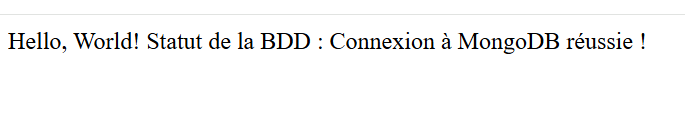

# TD-IDC ex 3

**docker --version :** Docker version 29.9.2, build a82e528

**docker images :** IMAGE   ID             DISK USAGE   CONTENT SIZE   EXTRA

**docker pull hello-world :** latest: Pulling from library/hello-world
4f55086f7dd0: Pull complete 
d5e71e642bf5: Download complete 
Digest: sha256:c567b231f65614688711a75f31518a064258a51d442117a3e771a3a8fdba78ef
Status: Downloaded newer image for hello-world:latest
docker.io/library/hello-world:latest

**docker run hello-world :** 
Hello from Docker!
This message shows that your installation appears to be working correctly.

To generate this message, Docker took the following steps:
 1. The Docker client contacted the Docker daemon.
 2. The Docker daemon pulled the "hello-world" image from the Docker Hub.
    (amd64)
 3. The Docker daemon created a new container from that image which runs the
    executable that produces the output you are currently reading.
 4. The Docker daemon streamed that output to the Docker client, which sent it
    to your terminal.

To try something more ambitious, you can run an Ubuntu container with:
 $ docker run -it ubuntu bash

Share images, automate workflows, and more with a free Docker ID:
 https://hub.docker.com/

For more examples and ideas, visit:
 https://docs.docker.com/get-started/

 **docker ps :** CONTAINER ID   IMAGE     COMMAND   CREATED   STATUS    PORTS     NAMES

 **docker ps -a :**
 CONTAINER ID   IMAGE         COMMAND    CREATED         STATUS                     PORTS     NAMES
5ea4c7b5a9e2   hello-world   "/hello"   2 minutes ago   Exited (0) 2 minutes ago             trusting_lamarr

**docker rm 5ea4c7b5a9e2** : 5ea4c7b5a9e2

**docker rmi c567b231f656** : Untagged: hello-world:latest
Deleted: sha256:c567b231f65614688711a75f31518a064258a51d442117a3e771a3a8fdba78ef

# TD-IDC ex 4

** docker pull nginx** : Using default tag: latest
latest: Pulling from library/nginx
6d2e43921e9e: Pulling fs layer 
37fb86c2a767: Extracting 1 s
512ac5e7ce8e: Download complete 
6d2e43921e9e: Pull complete 
bbb080c71d50: Pull complete 
1962e1ff75b4: Pull complete 
7cb4701ce7cd: Pull complete 
d2c7e31f04a3: Download complete 
4582dace95e2: Download complete 
Digest: sha256:165ddde8751e75a1c907d24ef10d9f6deb08b57e0fe56caf67512486aff76d82
Status: Downloaded newer image for nginx:latest
docker.io/library/nginx:latest

**docker run -d -p 8080:80 --name mon_nginx nginx** : d29e1dd945fba10990c4a16ddebb00bb25fda9b8494f6f875f04f71f5a03f997

**docker ps** : CONTAINER ID   IMAGE     COMMAND                  CREATED          STATUS          PORTS                                     NAMES
d29e1dd945fb   nginx     "/docker-entrypoint.…"   50 seconds ago   Up 50 seconds   0.0.0.0:8080->80/tcp, [::]:8080->80/tcp   mon_nginx

**docker stop mon_nginx** : mon_nginx

**docker rm mon_nginx** : mon_nginx

**Exo 6**

