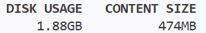
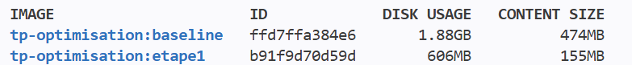
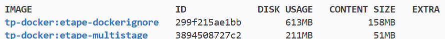

# Baseline

# Etape 1

choix d'une version précise et allegé de l'image

gain de 66% de taille

# Etape 2

optimise le cache et réduis le temps de build (ne réduis pas la taille)

# Etape 3

USER node au lieu de USER root car c'est une faille de sécurité majeure

# Etape 4 

Passage en multistage pour séparé la compilation de l'éxecution.
Cela permet de ne pas garder les outils lourd et les fichiers iniutiles dans l'image finale

Gain de 66% de taille de plus

# Conclusion

Entre le premiere version non optimisé et la version 4 optimisé la taille de l'image a baissé de 92%
