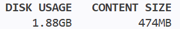
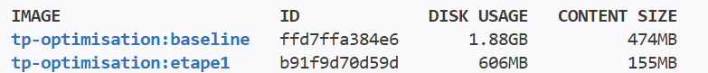

# Baseline

# Etape 1

choix d'une version précise et allegé de l'image

gain de 66% de taille

# Etape 2

optimise le cache et réduis le temps de build (ne réduis pas la taille)

# Etape 3

USER node au lieu de USER root car c'est une faille de sécurité majeure

